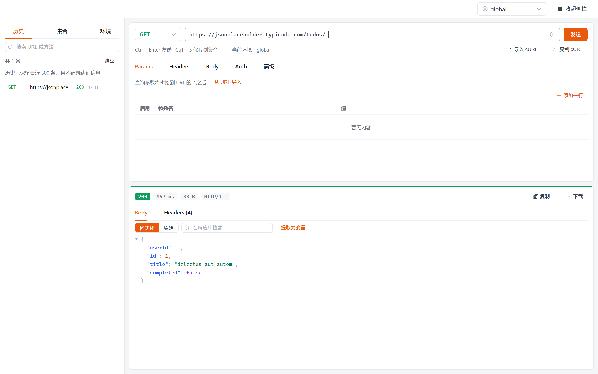

# HTTP Request Tool（http-request-tool）

> 便携、轻量的 Windows 桌面 HTTP 请求调试工具 —— 类似"精简版 Postman"，单个 exe，双击即用。

- **零安装、零运行时依赖**：一个 exe 搞定，数据存程序目录下的 `http-tool.db`（SQLite 单文件），整个目录拷到 U 盘即可带走
- **够用就好**：常用方法、Header、Query、Body、Auth、代理、超时一屏配完，不做团队协作/云同步那套重的东西
- **界面**：Vue 3 + Element Plus；**内核**：Rust + `reqwest` + `rusqlite`（bundled，无外部依赖）

## 界面



> 截图为浏览器 dev 预览模式（mock 层会**真实发起请求**），界面与打包后的桌面版一致，仅少系统窗口边框。
> 自己也能抓：`npx vite --port 5199` 起前端，再 `node scripts/shoot-ui.mjs`（脚本里是真实点击路径）。
## 功能

**请求**
- 方法、URL、Query 参数、自定义 Header（增删改、逐行启用/禁用）
- Body 类型：JSON / 表单 / 原始文本 / 文件上传
- Auth：Basic / Bearer Token / API Key（自定义 Header 名）
- 高级：跟随重定向、跳过证书校验、超时、自定义代理

**响应**
- 状态码、耗时、响应头、响应体（JSON 折叠查看）
- 大响应体写入文件（不把整个 body 塞进内存）
- 请求进行中可取消

**组织**
- **集合（Collections）**：新建/删除/导出/导入（JSON 文件）
- **已保存请求**：保存、更新、删除、**拖拽排序**、搜索
- **历史**：自动记录、单条删除、清空
- **环境变量**：多环境、键值管理，URL/Body/Header 里用 `{{var}}` 引用；发送前会检查未定义变量并提示

**互操作**
- **cURL 导入/导出**：把浏览器 DevTools 里的 cURL 直接贴进来，或把当前请求导出成 cURL
- 导出/导入集合文件，便于换机器或分享

## 技术栈

| 层 | 选型 |
|---|---|
| 桌面壳 | Tauri v2 |
| 后端 | Rust：`reqwest`（HTTP）、`rusqlite`（bundled SQLite）、`serde` |
| 前端 | Vue 3 + TypeScript + Element Plus + Vite |

## 快速开始

从源码运行（需要 Node 18+、Rust stable、[Tauri 前置依赖](https://tauri.app/start/prerequisites/)）：

```bash
npm install
npx tauri dev
```

构建便携版 exe：

```bash
npx tauri build
```

> 也可以直接用 [`Releases`](../../releases) 里发布的便携包，解压双击即可，无需安装任何运行时。

## 数据在哪

程序目录下的 `http-tool.db`（SQLite 单文件，含集合、已保存请求、历史、环境变量、设置）。
它被 `.gitignore` 排除在版本库外 —— **请勿把自己的请求历史提交到仓库**，里面可能带 Cookie、Token 等敏感值。

整个文件夹可以整体拷走；换机器后历史与集合一起跟过去。

## 已知限制

- 目前只提供 Windows 构建（Tauri 跨平台能力具备，但我只在 Windows 上验证过）。
- 未做代码签名，首次运行可能被 SmartScreen 拦一下：点「更多信息」→「仍要运行」。
- 不做团队协作 / 云同步 / 账号体系 —— 这个工具的定位是"本地、轻、随手可用"。

## 许可

[MIT](LICENSE)
